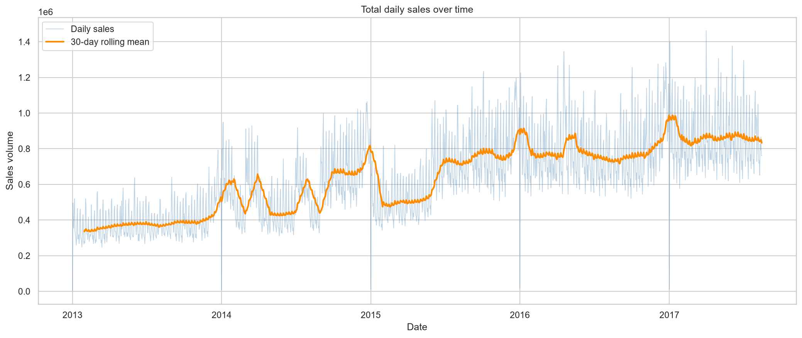
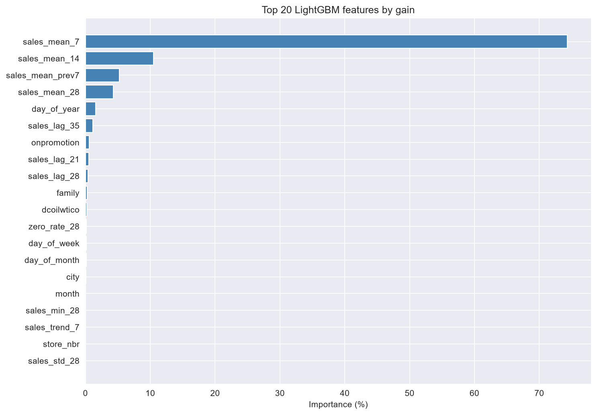

# Retail Demand Forecasting

16-day daily sales forecasts for **1,782 time series** (54 stores × 33 product families) of Corporación Favorita, an Ecuadorian grocery chain. The project builds an honest benchmark with time-based backtesting, then trains one global LightGBM model that beats the best baseline by **17.9%**.

| | RMSLE (lower is better) |
|---|---|
| Best baseline (`mean_28`) | 0.522 |
| **Global LightGBM** | **0.428** |

*The forecasts and error tables from this project feed the [Demand Planning Copilot](https://github.com/anCar16/demand-planning-copilot), an LLM agent that lets planners ask about them in plain language.*

## The problem

A grocery chain has to decide every day how much of each product family to send to each store. Too little means empty shelves and lost sales; too much means waste, especially for perishables. The task, taken from the Kaggle competition [Store Sales – Time Series Forecasting](https://www.kaggle.com/competitions/store-sales-time-series-forecasting), is to forecast daily unit sales for every store and family over the next **16 days**.

- **Data:** 3.0 million daily rows from 2013-01-01 to 2017-08-15, plus stores, transactions, oil prices and holidays.
- **Metric:** RMSLE (root mean squared logarithmic error). It measures relative error, so a miss of 10 units on a family that sells 20 counts more than the same miss on one that sells 2,000.



## Approach

The work is split into four notebooks, each with a single responsibility:

| Notebook | What it does |
|---|---|
| [`01_data_validation_and_eda`](notebooks/01_data_validation_and_eda.ipynb) | Schema and integrity checks, trend, weekday pattern, zero-sales rate by family, promotions |
| [`02_baselines_and_backtesting`](notebooks/02_baselines_and_backtesting.ipynb) | Temporal holdout (last 16 days) and five leakage-free baselines |
| [`03_feature_engineering`](notebooks/03_feature_engineering.ipynb) | Leakage-safe features built from 12 historical cutoffs |
| [`04_lightgbm_model`](notebooks/04_lightgbm_model.ipynb) | Global LightGBM, evaluation, error analysis, final training and Kaggle submission |

### 1. Validation that mimics production

The last 16 days of history (2017-07-31 to 2017-08-15) are held out and never used for training or feature building. This simulates standing at the end of 2017-07-30 and forecasting the next 16 days: 28,512 predictions (1,782 series × 16 days).

### 2. Baselines first

Any model has to beat simple rules. All of them use only data up to the cutoff:

| Baseline | Rule | RMSLE |
|---|---|---|
| **`mean_28`** | **Mean of the last 28 days** | **0.5216** |
| `seasonal_7` | Repeat the last week | 0.6170 |
| `seasonal_14` | Repeat the last 14 days | 0.6252 |
| `seasonal_28` | Sale from exactly 28 days earlier | 0.6274 |
| `last_value` | Repeat the last known sale | 0.6595 |

The smoothest rule wins: daily sales per series are noisy, and averaging beats copying any single day.

### 3. Leakage-safe features

For a cutoff `C`, the targets are `C+1 … C+16`. Every feature uses only information available at `C`:

- **Rolling statistics** over the last 7, 14 and 28 days (mean, std, min, max, zero rate, trend).
- **Lags of at least 16 days** (16, 21, 28, 35), so no lag points inside the forecast window, even for day 16.
- **Known-in-advance variables:** promotions, calendar, day of the forecast horizon, oil price (forward-filled with past values only) and holidays matched to the stores they actually affect (national → all stores, regional → `state`, local → `city`; transferred holidays removed).
- **Store attributes:** city, state, type and cluster.

Twelve cutoffs spaced 28 days apart (2016-08-28 to 2017-07-02) give 342,144 training rows. The notebook ends with strict integrity assertions (row counts, duplicates, nulls) that must pass before modeling.

### 4. One global model

A single LightGBM model learns from all 1,782 series at once (36 features), so sparse series borrow strength from similar ones. The target is `log1p(sales)`, which makes the squared-error objective match RMSLE. Early stopping (150 rounds) on the holdout selected **1,508 trees**. The final model is retrained on all labeled windows with that number of trees to produce the Kaggle submission.

## Results

| Model | RMSLE | vs. best baseline |
|---|---|---|
| `mean_28` baseline | 0.5216 | — |
| **LightGBM** | **0.4280** | **−17.9%** |

Over the 16 holdout days the model predicted 13.64 M units against 13.32 M actual (+2.4%), so the aggregate bias is small.

### Error across the horizon

Error grows only slightly from the first to the last day (0.409 on day 1, 0.432 on day 16, peak 0.463 on day 12). Because every lag is at least 16 days old, the model does not depend on recent values it would not have deeper into the horizon.

### Error by family

| Hardest families | RMSLE | | Easiest families | RMSLE |
|---|---|---|---|---|
| School and office supplies | 1.054 | | Books | 0.080 |
| Grocery II | 0.655 | | Dairy | 0.167 |
| Lingerie | 0.632 | | Produce | 0.173 |

**School and office supplies** is the clear outlier: the holdout falls in the back-to-school buying period of Ecuador's Sierra region (classes start in September), and the model forecast 9,433 units against 51,795 actually sold (−82%). The features describe the last 28 days, not what happened in August last year, so a yearly event is invisible to the model. *Books* looks easy only because it barely sells (9 units in the whole holdout).

### What drives the model



Recent level dominates: the 7-day mean alone accounts for 74% of the total gain, and the four rolling means together for 94%. Calendar effects (`day_of_year`) and promotions add a little on top.

## Limitations

- **One validation cut.** The score comes from a single 16-day window. A model choice made on one window can be lucky; several backtest cuts would give a more reliable estimate.
- **Yearly seasonality is weak.** No lag reaches back a full year, which explains the school-season miss.
- **No hyperparameter tuning** beyond early stopping.

## Next steps

- [ ] Add a 364-day lag and a regional school-calendar feature (Sierra vs. Costa start dates).
- [ ] Add payday features (public-sector wages are paid on the 15th and the last day of the month).
- [ ] Evaluate on several rolling backtest cuts instead of one.
- [ ] Submit to Kaggle and report the public score next to the internal one.
- [ ] Move the notebook logic into a tested `src/` package with a CLI for batch forecasts.

## Getting started

Requirements: Python 3.11 and [uv](https://docs.astral.sh/uv/).

```bash
uv sync
```

The data comes from the Kaggle competition and is not redistributed here. Download it into `data/raw/`:

```bash
# Option A: Kaggle CLI (needs a Kaggle API token and accepting the competition rules)
kaggle competitions download -c store-sales-time-series-forecasting -p data/raw
unzip data/raw/store-sales-time-series-forecasting.zip -d data/raw

# Option B: download the zip from the competition's Data tab and extract it into data/raw/
```

Then run the notebooks in order (`uv run jupyter lab`). Notebook 03 writes the feature tables to `data/interim/`, and notebook 04 writes models to `models/`, predictions to `data/processed/` and the metrics and figures to `reports/`.

## Project structure

```
notebooks/            01 → 04, run in order
reports/
  figures/            EDA and feature importance charts
  lightgbm_*.csv      error by family, error by horizon, feature importance
  lightgbm_validation_metrics.json
data/raw/             Kaggle CSVs (not versioned)
data/interim/         feature tables (generated)
data/processed/       validation predictions and submission (generated)
models/               trained models (generated)
```

## Tech stack

Python · Polars · pandas · LightGBM · scikit-learn · Matplotlib / seaborn · Jupyter · uv

## Data

The Corporación Favorita data belongs to its owners and is subject to the Kaggle competition rules.
